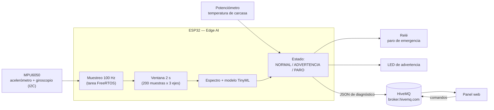

# MotorGuard — Detector de desbalance y fallas en motores (TinyML)

**Autor:** Josue Alexander Mazariegos López · Proyecto Integrador Final IoT & Web 4.0 (Módulo 4) · Vía **Edge AI**

**Problema:** las bombas y motores industriales sufren daños mecánicos severos por vibraciones anómalas (desbalance, desalineación, rodamientos) que no se detectan a tiempo.
**Solución:** un ESP32 mide la vibración a 100 Hz, ejecuta un modelo TinyML **dentro del microcontrolador**, corta la energía del motor con un relé si confirma una falla y reporta solo el diagnóstico por MQTT a HiveMQ. La señal cruda nunca sale del dispositivo.

## Arquitectura



**Lógica de decisión:** una ventana es "falla" si la clase no es `normal` con confianza ≥ 80 %, o si el puntaje de anomalía supera el umbral. 1 ventana fallida → **ADVERTENCIA** (LED parpadea). 3 consecutivas (~3 s) → **PARO** (relé abierto, LED fijo, queda enclavado hasta rearmar). Temperatura ≥ 80 °C → advertencia, ≥ 95 °C → paro. El rearme se rechaza si la carcasa sigue caliente. El relé está energizado mientras el motor corre, así que si el ESP32 pierde energía el motor se detiene (fail-safe). El paro local no depende de WiFi ni de MQTT.

## Lista de materiales (BOM)

| Cant. | Componente | Función |
|---|---|---|
| 1 | ESP32 DevKit C v4 | Núcleo: muestreo, inferencia, MQTT |
| 1 | MPU6050 | Sensor 1: vibración (aceleración 3 ejes) y giro |
| 1 | Potenciómetro | Sensor 2: temperatura de carcasa (20–120 °C) |
| 1 | Módulo relé | Actuador: paro de emergencia (alimenta el motor) |
| 1 | LED rojo + 220 Ω | Advertencia |
| 1 | LED verde + 220 Ω | Indica motor energizado (carga del relé en la simulación) |
| 2 | Pulsadores | Cambiar falla simulada / rearmar |

## Conexiones

| ESP32 | Destino |
|---|---|
| 3V3 | MPU6050 VCC, potenciómetro VCC |
| 5V | Relé VCC y COM |
| GND | MPU6050, potenciómetro, relé, cátodos de LED, pulsadores |
| GPIO21 / GPIO22 | MPU6050 SDA / SCL |
| GPIO34 | Potenciómetro SIG |
| GPIO26 | Relé IN (HIGH = bobina energizada = motor alimentado) |
| GPIO27 | LED rojo (vía 220 Ω) |
| GPIO4 / GPIO5 | Pulsador "Falla" / pulsador "Rearme" (a GND, con pull-up interno) |
| — | Relé NO → 220 Ω → LED verde → GND |

## Cómo ejecutarlo en Wokwi

1. En [wokwi.com](https://wokwi.com) crea un proyecto **ESP32** (Arduino).
2. Reemplaza `diagram.json` y `libraries.txt` con los de `wokwi/`.
3. Pega `sketch.ino` y crea tres archivos con el botón "+": `motorguard_dsp.h`, `motorguard_sim.h` y `modelo_local.h`.
4. Pulsa ▶. Verás en la consola la conexión WiFi y MQTT y un diagnóstico por segundo.
5. Abre `dashboard/index.html` en el navegador (necesita internet). Usa el mismo ID de alumno que en `ID_ALUMNO`.

Si el LED verde queda al revés, cambia `RELE_NIVEL_ACTIVO` a `LOW` o agrega `"transistor": "pnp"` al relé en `diagram.json`. Si los componentes se solapan, arrástralos: las conexiones se conservan.

**Demostración de fallas:** Wokwi no simula física, así que el MPU6050 solo entrega los valores de sus sliders. El firmware suma una firma de vibración sintética a la lectura I2C real (`SIMULAR_VIBRACION 1`). El pulsador "Falla" cambia entre motor sano, desbalance, desalineación y rodamiento. También puedes hacerlo desde el panel web. Con hardware real, pon `SIMULAR_VIBRACION 0`.

## Modelo TinyML

El proyecto trae **dos motores de inferencia** con las mismas características de entrada:

- **Modelo local (por defecto, `USE_EDGE_IMPULSE 0`):** centroides de clase + detector de anomalías K-means entrenado solo con datos normales. Se genera con `python tools/generar_dataset.py` y queda en `wokwi/modelo_local.h`. Corre en Wokwi web sin dependencias extra.
- **Edge Impulse (`USE_EDGE_IMPULSE 1`):** el modelo que pide la rúbrica.

### Entrenar en Edge Impulse

1. `python tools/generar_dataset.py` crea `dataset_edgeimpulse/` con CSV `timestamp,accX,accY,accZ` (30 archivos de 10 s por clase: `normal`, `desbalance`, `desalineacion`, `rodamiento`).
2. En Edge Impulse Studio: **Data acquisition → Upload data**, selecciona todos los CSV, etiqueta "infer from filename", frecuencia 100 Hz y división train/test automática.
3. **Impulse design:** *Time series data* con ventana 2000 ms, incremento 1000 ms, 100 Hz, ejes accX/accY/accZ. Bloque *Spectral Analysis*, bloque *Classification* y bloque *Anomaly detection (K-means)*.
4. Genera características, entrena y revisa la matriz de confusión en *Model testing*.
5. **Deployment → Arduino library → Build.** Ajusta `UMBRAL_ANOM` en el sketch según lo que veas en Studio.
6. Pon `USE_EDGE_IMPULSE 1` y cambia el `#include` por el nombre de tu librería (`<..._inferencing.h>`).

Para esta vía usa **PlatformIO + extensión Wokwi para VS Code**: copia la librería exportada a `lib/`, el sketch a `src/main.cpp` junto con los `.h`, y agrega:

```ini
; platformio.ini
[env:esp32dev]
platform = espressif32
board = esp32dev
framework = arduino
monitor_speed = 115200
lib_deps = knolleary/PubSubClient@^2.8
```
```toml
# wokwi.toml
[wokwi]
version = 1
firmware = '.pio/build/esp32dev/firmware.bin'
elf = '.pio/build/esp32dev/firmware.elf'
```

Si el compilador reporta `ei_run_impulse was not declared`, es una incompatibilidad conocida entre la librería de Edge Impulse y versiones nuevas del core de ESP32; la documentación de Edge Impulse indica la solución.

## MQTT (HiveMQ público, puerto 1883; WebSocket 8000)

Base: `curso_iot_2026/<ID_ALUMNO>/motorguard`

| Topic | Dirección | Contenido |
|---|---|---|
| `/telemetria` | ESP32 → nube, cada 2 s | `{"estado","clase","conf","anom","umbral","rms_g","temp_c","rele","sim","fs_hz","jitter_us","gyro_dps","dsp_us","rssi"}` |
| `/alerta` | ESP32 → nube, al cambiar de estado | `{"tipo","causa","conf","anom","temp_c"}` |
| `/estado` | ESP32 → nube, retenido | `online` / `offline` (último deseo) |
| `/comando` | nube → ESP32 | `rearmar`, `paro`, `sim:normal\|desbalance\|desalineacion\|rodamiento` |

El broker es público: cualquiera que conozca el topic puede publicar en él. Usa un ID de alumno único. El panel valida todo lo que recibe y nunca inserta HTML.

## Qué se validó y qué no

Validado en PC antes de entregarte esto:
- El DSP y el modelo de C++ clasifican correctamente 1 200 ventanas generadas por el mismo simulador del firmware (`tools/validacion_host.cpp`), con 0 falsas alarmas en operación normal.
- El `sketch.ino` real, ejecutado con reloj virtual: la falla simulada produce advertencia a ~1.3 s y **paro a ~3.3 s**; el rearme no genera falsas alarmas; sobretemperatura y rechazo de rearme funcionan.
- El sketch pasa verificación de sintaxis con `-Wall -Wextra` en ambos modos.

**No** pude validar: la ejecución dentro de Wokwi (cableado, tiempos reales de I2C/WiFi), la conexión real a HiveMQ, ni el modelo de Edge Impulse (requiere tu cuenta y tu entrenamiento). Los logs de consola del Entregable 2 tienes que capturarlos de tu propia simulación.

La exactitud de 100 % es sobre **datos sintéticos** muy separables y no representa el desempeño en un motor real. Para hardware físico habría que capturar datos reales con el MPU6050 y reentrenar.

## Límites de diseño (para las preguntas técnicas)

- A 100 Hz el límite de Nyquist es 50 Hz. Por eso el motor simulado gira a 900 rpm (15 Hz) y se analizan armónicos hasta 3x (45 Hz). Motores de 1 800–3 600 rpm necesitan muestrear a ≥ 500 Hz.
- El MPU6050 se configura con filtro pasa-bajos de 44 Hz como anti-aliasing a esta frecuencia.
- El firmware mide el jitter del periodo de 10 ms y la frecuencia efectiva y los reporta en cada telemetría como evidencia del muestreo constante.
- Tráfico: ~210 B cada 2 s de diagnóstico (≈105 B/s), frente a 600 B/s de señal cruda en binario (100 Hz × 3 ejes × 2 B).
- Si el broker cae, el socket MQTT tiene timeout de 2 s; la lectura de sensores sigue en su propia tarea.

## Guion sugerido del pitch (5–7 min)

1. **Problema (30 s):** costo de una falla no detectada en una bomba.
2. **Arquitectura (1 min):** diagrama de arriba; por qué inferir en el borde y no enviar la señal cruda.
3. **Demo en vivo (2–3 min):** motor sano → pulsa "Falla" → advertencia → paro a los ~3 s con relé abierto y LED → panel web y consola → girar el potenciómetro sobre 80 °C y 95 °C → rearme.
4. **TinyML (1 min):** dataset, matriz de confusión de Edge Impulse, tamaño y tiempo de inferencia (`dsp_us` en la telemetría).
5. **Viabilidad y límites (1 min):** datos sintéticos, siguiente paso con sensor real a mayor frecuencia.

## Correspondencia con la rúbrica

| Criterio | Dónde está |
|---|---|
| Arquitectura y diseño (20 %) | Diagrama y BOM de este README |
| Hardware/firmware (30 %) | `wokwi/diagram.json`, `wokwi/sketch.ino` (comentado) |
| Integración y conectividad (30 %) | MQTT a HiveMQ, modelo TinyML local, `dashboard/index.html` |
| Presentación y viabilidad (20 %) | Guion y límites de arriba |

## Estructura

```
MotorGuard/
├── README.md
├── wokwi/        sketch.ino, motorguard_dsp.h, motorguard_sim.h, modelo_local.h, diagram.json, libraries.txt
├── tools/        generar_dataset.py, validacion_host.cpp
└── dashboard/    index.html
```

Prueba en PC del modelo: `g++ -O2 -Iwokwi tools/validacion_host.cpp -o validacion_host && ./validacion_host`
